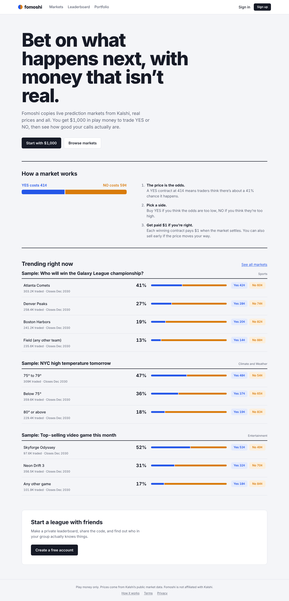

# Fomoshi

Paper-trade real prediction markets with play money.

Fomoshi mirrors the open markets on [Kalshi](https://kalshi.com) using its public data. You get $1,000 of fake money to bet YES or NO on elections, the economy, sports, and more. Prices are live, orders fill against Kalshi's real order book, and winning positions pay out when the market settles.



## What you can do

- **Browse markets**: search, filter by category, and see probability charts
- **Follow games**: live and upcoming matchups (Team A vs Team B) with prices that update every few seconds
- **Trade**: buy or sell YES/NO contracts at Kalshi's current prices
- **Track your portfolio**: profit and loss, trade history, and account value over time
- **Compete**: climb the global leaderboard or start a private league with friends

## How it works

A contract pays **$1** if it's right and **$0** if it's wrong, so a price of 40¢ means the market thinks there's about a 40% chance. Buy low on outcomes you believe in, and sell if the price moves your way.

## Run it locally

You'll need Python 3.11+ and Node.js.

**Backend** (http://localhost:8000):

```bash
cd backend
python -m venv .venv
.venv/Scripts/activate        # macOS/Linux: source .venv/bin/activate
pip install -r requirements.txt
uvicorn app.main:app --reload
```

**Frontend** (http://localhost:5173):

```bash
cd frontend
npm install
npm run dev
```

It works out of the box with SQLite and live Kalshi data. To work offline with sample data, set `KALSHI_MODE=mock` before starting the backend.

**Or with Docker:** create a `.env` file in the project root containing `SECRET_KEY=<any long random string>`, then run `docker compose up --build` and open http://localhost:8080.

## Built with

React + TypeScript (Vite) · FastAPI · PostgreSQL or SQLite · Redis (optional)

---

Play money only. Fomoshi is not affiliated with Kalshi.
