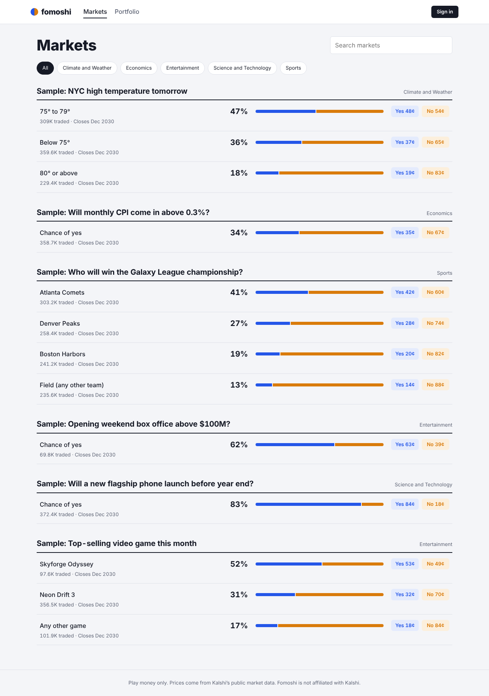

# Fomoshi

Paper-trade prediction markets with live prices and play money.

Fomoshi pulls real markets and order books from [Kalshi's public API](https://docs.kalshi.com/getting_started/quick_start_market_data) and lets you trade YES or NO on them with $1,000 of fake money. Orders fill against the live order book, so a big order moves through price levels the way it would on a real exchange. When Kalshi settles a market, Fomoshi pays out your positions automatically.


| Markets | Portfolio |
|---|---|
|  |  |

## How it works

Every contract pays **$1** if its side wins and **$0** if it loses, so a YES price of 41¢ means the market thinks there's about a 41% chance of YES.

Kalshi only publishes **bids**. Because YES and NO always add up to $1, a NO bid at 58¢ is the same as someone offering YES at 42¢. Fomoshi derives the asks from the opposite side's bids:

```
best YES ask = $1 − best NO bid
best NO ask  = $1 − best YES bid
```

A buy order walks the asks from cheapest up; a sell walks the bids from highest down. Orders are **immediate-or-cancel**: whatever can't fill right away (or would break your limit price) is cancelled. See [`backend/app/trading/orderbook.py`](backend/app/trading/orderbook.py).

Money is stored as integer **micros** (millionths of a dollar), never floats, so balances never pick up rounding errors.

## Stack

| Layer | Tech |
|---|---|
| Frontend | React 19, TypeScript, Vite, React Router |
| Backend | FastAPI, SQLAlchemy 2, Pydantic |
| Database | SQLite by default, Postgres via `DATABASE_URL` |
| Auth | bcrypt password hashes, JWT bearer tokens |
| Market data | Kalshi public REST API, cached in memory (3–30s per endpoint) |
| Background jobs | Settlement loop inside the API process (or run it from cron) |
| CI | GitHub Actions: ruff, pytest, TypeScript build |

## Running it locally

You need Python 3.11+ and Node 20+.

**Backend**

```bash
cd backend
python -m venv .venv && source .venv/bin/activate   # Windows: .venv\Scripts\activate
pip install -r requirements-dev.txt
cp .env.example .env        # then set SECRET_KEY
uvicorn app.main:app --reload
```

API docs are at http://localhost:8000/docs.

**Frontend** (in a second terminal)

```bash
cd frontend
npm install
npm run dev
```

Open http://localhost:5173. Vite forwards `/api` requests to the backend.

**Offline / demo mode.** Set `KALSHI_MODE=mock` in `backend/.env` to use the sample markets in `backend/app/kalshi/fixtures` instead of live data. The tests always use mock mode.

**Tests**

```bash
cd backend && pytest
```

## Project layout

```
backend/
  app/
    kalshi/client.py        Kalshi API client (live + mock) with response caching
    trading/orderbook.py    order book parsing and fill simulation (pure functions)
    trading/engine.py       executes trades, updates cash and positions
    trading/settlement.py   pays out positions when markets settle
    routers/                auth, markets, trades, portfolio endpoints
    models.py               User, Position, Trade tables
  tests/                    pytest suite
frontend/
  src/pages/                Markets, Market (trade ticket + order book), Portfolio, Login
  src/api.ts                typed API client
```

## API

| Method | Path | What it does |
|---|---|---|
| POST | `/api/auth/register` | Create an account (starts with $1,000) |
| POST | `/api/auth/login` | Get a token |
| GET | `/api/auth/me` | Current user and cash |
| GET | `/api/markets?q=&category=` | Open events with their markets |
| GET | `/api/markets/{ticker}` | One market |
| GET | `/api/markets/{ticker}/orderbook` | Bids and derived asks for both sides |
| POST | `/api/trades/preview` | What an order would fill at, without placing it |
| POST | `/api/trades` | Place an order |
| GET | `/api/trades` | Your trade history |
| GET | `/api/portfolio` | Cash, positions marked to the current bid, total P&L |

## Known simplifications

- Orders fill against a snapshot of Kalshi's book but don't consume it, so two users can both take the same liquidity.
- Kalshi's trading fees aren't simulated yet.
- Positions are marked at the best bid (what you could sell for now), which is conservative for thin markets.
- Limit orders don't rest on the book; they fill immediately or not at all.

## Roadmap

- [x] Live Kalshi markets and order books
- [x] Buy/sell YES and NO with order-book fills and limit prices
- [x] Portfolio with live P&L and trade history
- [x] Automatic settlement
- [ ] Price history charts (Kalshi candlesticks endpoint)
- [ ] Leaderboard and weekly leagues with friends
- [ ] Calibration stats: how often your 70% bets actually win
- [ ] Resting limit orders that fill when the live price crosses them
- [ ] Simulated Kalshi fees
- [ ] Redis cache shared across API workers
- [ ] Alembic migrations, Docker Compose, deploy

## Disclaimer

Fomoshi is a simulator. It uses play money only: no deposits, no withdrawals, no prizes. Market data comes from Kalshi's public API; Fomoshi is not affiliated with or endorsed by Kalshi.
